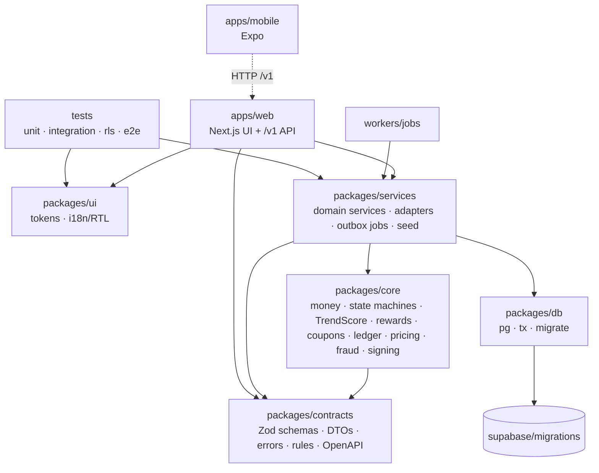
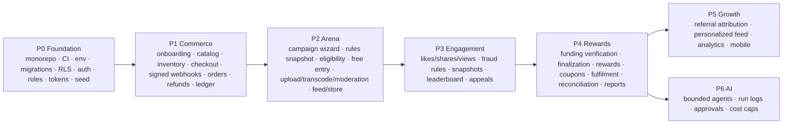

# Dependency graph

## Packages



## Delivery order (each phase ends in a demonstrable slice)



## Runtime event flow

```
checkout ─► provider (hosted) ─► POST /v1/webhooks/:provider ─► webhook_events (unique) ─► outbox
outbox: webhook.process → order PAID → journal → order.status_changed → entitlement (at milestone)
upload PUT /v1/uploads/:token → video.uploaded → transcode/validate/hash → video.asset.ready → moderation queue
engagement events (validity at write) → tick: provisional snapshot ≤60 s → vote_end: cutoff snapshot
admin finalize (idempotent, locked) → rewards + coupons → campaign.finalized → merchant fulfilment → FULFILLED
refund/dispute webhook → order.refunded → eligibility review flag (never silent revocation)
```
